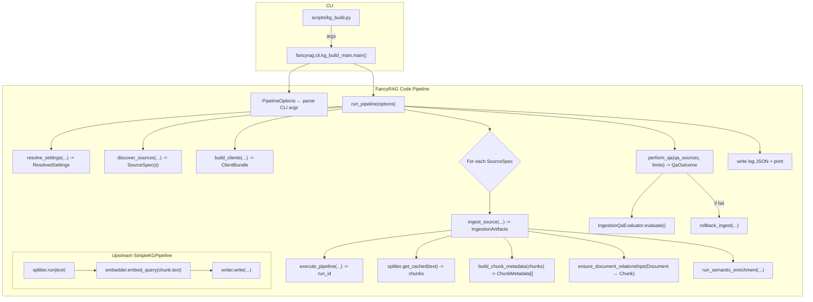

# DR_01 — FancyRAG Inventory: Ingestion & KG Build

**Scope:** Exhaustive inventory of FancyRAG’s ingestion + knowledge graph build workflows (imperative and YAML/config-driven), with upstream touchpoints and replaceability notes.

**Authoritative code sources (per run constraints):**
- Upstream: https://github.com/neo4j/neo4j-graphrag-python.git  
- Custom: https://github.com/DrJLabs/FancyRAG.git  

> Note: “Evidence” references are preserved as they appeared in the research output (e.g., `【…†Lx-Ly】`). They are intended to point to specific files/line ranges within the authoritative repos.

---

## 1) Ingestion Entrypoints

FancyRAG currently supports two entrypoints for launching the knowledge-graph ingestion pipeline, one via a YAML-driven pipeline runner and another via an in-code orchestrator.

| Entrypoint Type | Path | Symbol/Command | How Invoked | Evidence |
|---|---|---|---|---|
| YAML Pipeline (Legacy) | `tools/run_pipeline.py` | `main()` (async) | Called by `make ingest` (uses `neo4j_graphrag.experimental.pipeline.config.PipelineRunner` to run `pipelines/kg_ingest.yaml`) | 【2†L23-L27】【1†L15-L18】 |
| Code Pipeline (Current) | `scripts/kg_build.py` (calls `fancyrag.cli.kg_build_main`) | `kg_build_main.main()` | Run manually or via future Makefile target (parses CLI args, calls `fancyrag.kg.pipeline.run_pipeline` in code) | 【10†L11-L19】【31†L25-L34】 |

### Canonical path determination

- The **code-based pipeline (`kg_build.py`) is intended to become the canonical ingestion path**, replacing the older YAML/PipelineRunner method【68†L47-L55】.  
- The Makefile’s current `ingest` target still uses the YAML approach, but notes indicate it should be updated to use `kg_build.py` for consistency with newer defaults【10†L3-L11】【10†L13-L21】.  

---

## 2) Exhaustive Symbol Inventory

Below is an inventory of the key classes, functions, and configuration surfaces involved in FancyRAG’s ingestion and KG build workflow(s), including where YAML keys interface with code.

### 2.1 Core Pipeline Orchestration (fancyrag.kg.pipeline & fancyrag.kg.phases)

| Module:Symbol | Signature (or Key) | Responsibilities | Side Effects | Callers / Callees | Evidence |
|---|---|---|---|---|---|
| `kg.pipeline:PipelineOptions` | `class PipelineOptions(source: Path, …, reset_database: bool)` | Aggregates pipeline run inputs (source(s), chunking, DB, QA limits, semantic flags) | None (config container) | Built by CLI parser and passed to `run_pipeline` | 【19†L371-L379】【19†L382-L389】 |
| `kg.pipeline:run_pipeline` | `def run_pipeline(options: PipelineOptions) -> dict[str, Any]` | High-level orchestrator: resolves settings, discovers sources, builds clients, ingests each source, runs QA, writes/prints run log | Writes log JSON; triggers rollback on QA failure | Called by CLI; calls `resolve_settings`, `discover_sources`, `build_clients`, `ingest_source`, `perform_qa` | 【16†L1362-L1370】【16†L1430-L1438】 |
| `kg.phases:resolve_settings` | `def resolve_settings(...)-> ResolvedSettings` | Merge chunking overrides with profile presets; validate sizes | Raises on invalid sizes | Called by `run_pipeline` | 【3†L81-L90】【3†L97-L105】 |
| `kg.pipeline:PROFILE_PRESETS` | dict: `{"text": {...}, "markdown": {...}, "code": {...}}` | Default chunking presets and include-glob patterns | — | Used by `resolve_settings`; set via `--profile` | 【33†L327-L336】【31†L48-L52】 |
| `kg.phases:discover_sources` | `def discover_sources(...) -> SourceDiscoveryResult` | Expand file/dir into SourceSpec list; read files; compute checksums | FS reads; raises on missing/empty match | Called by `run_pipeline` | 【3†L147-L155】【3†L164-L172】 |
| `kg.pipeline:SourceSpec` | `@dataclass SourceSpec(path, relative_path, text, checksum)` | Represents one ingested document | — | Created by `discover_sources`; passed to `ingest_source` | 【3†L147-L155】【3†L165-L172】 |
| `kg.phases:build_clients` | `def build_clients(...) -> ClientBundle` | Build shared OpenAI client, embedder, LLM, optional structured semantic LLM, caching splitter | External API readiness; splitter is stateful | Called by `run_pipeline`; uses factories for custom components | 【4†L200-L207】【41†L1403-L1410】 |
| `kg.phases:ClientBundle` | `@dataclass ClientBundle(...)` | Container for client objects | — | Created by `build_clients`; passed to `ingest_source` | 【4†L200-L207】【4†L208-L213】 |
| `kg.phases:ingest_source` | `def ingest_source(...)-> IngestionArtifacts` | Ingest one source: run upstream pipeline to write chunks; read cached chunks; build metadata; ensure Document↔Chunk links; create QA records; optional semantic enrichment | Writes to Neo4j; calls OpenAI; may reset DB on first file; logs | Called in `run_pipeline` loop; calls `execute_pipeline`, `ensure_document_relationships`, `run_semantic_enrichment` | 【4†L246-L254】【4†L274-L283】 |
| `kg.pipeline:ChunkMetadata` | `@dataclass ChunkMetadata(uid, sequence, index, checksum, relative_path, git_commit)` | Per-chunk provenance and identity metadata | — | Built from splitter output; used for linking and QA | 【19†L401-L409】 |
| `kg.pipeline:_build_chunk_metadata` | `def _build_chunk_metadata(...)-> list[ChunkMetadata]` | Convert chunk objects to ChunkMetadata; compute chunk text checksum; detect duplicate UIDs | Raises on duplicate UIDs | Called by `ingest_source` | 【19†L539-L548】【19†L549-L555】 |
| `db.neo4j_queries:ensure_document_relationships` | `def ensure_document_relationships(driver, ..., chunks_metadata)` | MERGE Document node; set provenance props; link `(:Document)-[:HAS_CHUNK]->(:Chunk)`; set stable `chunk_id` sequence | Neo4j writes/updates via Cypher | Called by `ingest_source` | 【55†L85-L93】【55†L97-L105】 |
| `kg.phases:IngestionArtifacts` | `@dataclass IngestionArtifacts(run_id, qa_source, log_entry, chunk_entries, semantic_stats)` | Container for per-source results | — | Returned by `ingest_source`; collected by `run_pipeline` | 【4†L349-L357】 |
| `kg.phases:perform_qa` | `def perform_qa(...)-> QaOutcome` | Run custom ingestion QA via `IngestionQaEvaluator`; write QA report; rollback on failure; return QA section and counts | Neo4j reads; may rollback deletes; writes report files | Called by `run_pipeline` after ingest loop | 【5†L374-L382】【5†L417-L425】 |
| `qa.evaluator:QaSourceRecord` | `@dataclass QaSourceRecord(..., chunks: list[QaChunkRecord], ingest_run_key)` | QA representation of an ingested source & its chunks | — | Created in `ingest_source`; used by QA and rollback | 【4†L282-L290】【47†L47-L55】 |
| `kg.pipeline:QaLimits` and `qa.evaluator:QaThresholds` | dataclasses for anomaly thresholds | Defaults to strict (0 allowed) unless CLI overrides | — | CLI builds QaLimits; perform_qa converts to QaThresholds | 【31†L81-L89】【47†L60-L68】 |
| `qa.evaluator:IngestionQaEvaluator` | `class IngestionQaEvaluator(...).evaluate()` | Run Cypher checks for counts, missing embeddings, orphan chunks, checksum mismatches; semantic counts if enabled; write markdown/json report; determine pass/fail | Neo4j reads; writes report | Called by `perform_qa` | 【47†L122-L130】【47†L179-L187】 |
| `db.neo4j_queries:rollback_ingest` | `def rollback_ingest(driver, ..., sources)` | Delete nodes/rels for a run (by ingest_run_key and chunk UIDs); delete orphaned Documents | Neo4j deletions (irreversible) | Called by `perform_qa` on QA failure | 【55†L129-L137】【55†L139-L147】 |
| `kg.pipeline:DEFAULT_SCHEMA` | `DEFAULT_SCHEMA = _load_default_schema()` | Load default graph schema from `scripts/config/kg_schema.json`; validate into GraphSchema | Fails on missing/invalid schema | Used to initialize pipeline and semantic extraction | 【19†L456-L462】【16†L1321-L1329】 |

### 2.2 FancyRAG Custom Components (OpenAI, Splitter, Semantic LLM)

| Module:Symbol | Signature / Definition | Responsibilities | Side Effects | Callers / Callees | Evidence |
|---|---|---|---|---|---|
| `cli.openai_client:SharedOpenAIClient` | (class) | Shared OpenAI-compatible client used by embedder and LLM wrappers | HTTP calls to OpenAI/proxy | Built by `build_clients`; used by Shared embedder/LLMs | 【4†L199-L207】【40†L1142-L1150】 |
| `kg.pipeline:SharedOpenAIEmbedder` | `class SharedOpenAIEmbedder(Embedder)` | Embedding generator via Shared client; validates embedding length | API calls; raises EmbeddingsGenerationError | Created in `build_clients`; used by upstream pipeline | 【40†L1142-L1150】【40†L1169-L1175】 |
| `kg.pipeline:SharedOpenAILLM` | `class SharedOpenAILLM(LLMInterface)` | Chat-completions wrapper via Shared client; fence stripping | API calls; raises LLMGenerationError | Created in `build_clients`; used by pipeline components | 【40†L1189-L1197】【40†L1238-L1246】 |
| `splitters:CachingFixedSizeSplitter` | `class CachingFixedSizeSplitter(FixedSizeSplitter)` | Adds caching + scoped namespaces; rehydrates chunks from blueprint to avoid resplitting | In-memory cache | Used by upstream pipeline and later for QA metadata | 【50†L94-L102】【50†L159-L165】 |
| `splitters:CachingSplitterConfig` | `@dataclass CachingSplitterConfig(chunk_size, chunk_overlap=0)` | Factory to create caching splitter | — | Built from PipelineOptions; used by `build_clients` | 【50†L77-L85】【53†L250-L258】 |
| `kg.semantic_llm:StructuredSemanticLLM` | `class StructuredSemanticLLM(LLMInterface)` | Enforces JSON schema output via OpenAI structured output; fallback strategies | API calls; retry on schema format failure | Used in semantic enrichment (extractor injected with this LLM) | 【37†L109-L118】【37†L133-L141】 |
| Upstream: `LLMEntityRelationExtractor` | `extract_for_chunk(...)-> Neo4jGraph` | LLM-driven entity/relation extraction; combine chunk graphs | LLM calls; async concurrency | Constructed in `run_semantic_enrichment` | 【43†L686-L694】【43†L705-L713】 |

### 2.3 Config-driven Pipeline (YAML / PipelineRunner path)

| Module/File:Symbol | Signature / Key | Responsibilities | Side Effects | Callers / Callees | Evidence |
|---|---|---|---|---|---|
| Upstream: `PipelineRunner` | `PipelineRunner.from_config_file(...).run(payload)` | Run YAML-defined pipeline | Instantiates/executes components per config | Used by `tools/run_pipeline.py` | 【1†L10-L18】 |
| `pipelines/kg_ingest.yaml` | YAML component graph | Defines splitter → embedder → extractor → writer → resolver. Uses gpt-4o-mini and local embedding model | Writes to Neo4j; may merge nodes via resolver | Consumed by PipelineRunner | 【29†L39-L47】【29†L78-L87】 |
| `Makefile: ingest` | `uv run python tools/run_pipeline.py $(f)` | Convenience target to run YAML path | Shell execution | Developer invocation | 【2†L23-L27】【10†L3-L11】 |

---

## 3) Call Graph

---

## 4) Config Surfaces

### 4.1 Environment variables (FancyRAG settings)

| Env Var | Default | Validation | Where Consumed | Evidence |
|---|---:|---|---|---|
| `NEO4J_URI` | — | must be proper scheme/host | `Neo4jSettings.uri` for driver | 【25†L483-L492】【25†L615-L623】 |
| `NEO4J_USERNAME` | — | non-empty | `Neo4jSettings.username` | 【25†L615-L623】 |
| `NEO4J_PASSWORD` | — | secret | `Neo4jSettings.password` | 【25†L615-L623】 |
| `NEO4J_DATABASE` | None | — | Passed to driver/query `database_=` | 【25†L618-L626】【55†L51-L59】 |
| `OPENAI_API_KEY` | — | — | `OpenAISettings.api_key` | 【27†L600-L608】 |
| `OPENAI_MODEL` | `gpt-5-mini` | must be allowed | `OpenAISettings.chat_model` | 【22†L17-L25】【23†L31-L39】 |
| `OPENAI_EMBEDDING_MODEL` / `EMBEDDING_MODEL` | `text-embedding-3-small` | — | `OpenAISettings.embedding_model` | 【23†L43-L51】 |
| `OPENAI_EMBEDDING_DIMENSIONS` / `EMBEDDING_DIMENSIONS` | 1024 (set 1536 for OpenAI `text-embedding-3-small`) | positive int | embedding length validation + vector index sizes | 【23†L73-L81】【2†L16-L24】 |
| `OPENAI_MAX_ATTEMPTS` | 3 | positive int | OpenAI retry count | 【23†L55-L63】 |
| `OPENAI_BACKOFF_SECONDS` | 0.5 | >0 float | OpenAI retry backoff | 【23†L73-L81】 |
| `OPENAI_TEMPERATURE` | 0.3 | >=0 float | LLM temperature | 【23†L91-L99】 |
| `OPENAI_ENABLE_FALLBACK` | true | boolean | allow fallback model | 【23†L109-L117】 |
| `OPENAI_BASE_URL` / `OPENAI_ALLOW_INSECURE_BASE_URL` | None / False | validate URL + scheme | route OpenAI calls to proxy | 【22†L75-L83】【22†L95-L104】 |
| `EMBEDDING_API_BASE_URL` / `EMBEDDING_API_KEY` | — | validate URL | route embedding calls to local service | 【22†L39-L47】 |
| `INDEX_NAME` | `text_embeddings` | — | Makefile index creation | 【2†L16-L24】 |
| `FULLTEXT_INDEX_NAME`, `FULLTEXT_LABEL`, `FULLTEXT_PROPERTY` | `chunk_text_fulltext`, `Chunk`, `text` | — | Makefile fulltext index creation | 【2†L19-L27】 |

### 4.2 YAML keys (`pipelines/kg_ingest.yaml` legacy path)

| YAML key | Default/Example | Where used | Evidence |
|---|---|---|---|
| `neo4j_config.params_.uri/user/password` | from env | PipelineRunner’s Neo4j config | 【29†L3-L11】 |
| `llm_config.class_` + `params_` | `OpenAILLM`, `model_name: gpt-4o-mini` | upstream LLM | 【29†L15-L24】 |
| `embedder_config.class_` + `params_` | `OpenAIEmbeddings`, `model: local-embedding-768` | upstream embeddings | 【29†L28-L37】 |
| `component_config.splitter` | `FixedSizeSplitter` | chunking | 【29†L39-L47】 |
| `component_config.embedder` | `TextChunkEmbedder` | chunk embeddings | 【29†L46-L52】 |
| `component_config.extractor` | `LLMEntityRelationExtractor` | entity/relation extraction | 【29†L52-L59】 |
| `component_config.writer` | `Neo4jWriter` | write graph | 【29†L58-L66】 |
| `component_config.resolver_exact` | `SinglePropertyExactMatchResolver` | dedupe/merge nodes | 【29†L68-L76】 |
| `connection_config` | splitter→embedder→extractor→writer→resolver | execution wiring | 【29†L78-L87】 |

---

## 5) Upstream Touchpoints

| FancyRAG use site | Upstream symbol | Stability | Replaceability note | Evidence |
|---|---|---|---|---|
| `_execute_pipeline` | `neo4j_graphrag.experimental.pipeline.kg_builder.SimpleKGPipeline` | Experimental | Keep/Wrap behind `_execute_pipeline` | 【41†L1316-L1324】【16†L1321-L1329】 |
| `run_semantic_enrichment` | `neo4j_graphrag.experimental.components.entity_relation_extractor.LLMEntityRelationExtractor` | Experimental | Keep; isolate in semantic module | 【43†L686-L694】【43†L705-L713】 |
| Semantic writing | `neo4j_graphrag.experimental.components.kg_writer.Neo4jWriter` | Experimental | Keep + subclass (`SanitizingNeo4jWriter`) | 【43†L741-L749】【43†L749-L757】 |
| Schema | `GraphSchema`, `Neo4jGraph` | Experimental | Keep; version-pin | 【19†L456-L462】【35†L27-L35】 |
| Splitter base | `FixedSizeSplitter` | Experimental | Keep; wrap with caching | 【50†L18-L27】【50†L91-L100】 |
| OpenAI core adapters | `OpenAIEmbeddings`, `OpenAILLM` | Stable | Replaced by SharedOpenAI* wrappers | 【40†L1142-L1150】【40†L1178-L1186】 |
| YAML runner | `PipelineRunner` | Experimental | Deprecate legacy path | 【1†L10-L18】【10†L13-L21】 |
| YAML dedupe | `SinglePropertyExactMatchResolver` | Experimental | Consider adding equivalent step in code path | 【29†L68-L76】 |

---

## 6) Initial Decision Matrix

| Component | REPLACE/WRAP/ADAPT/KEEP/SPLIT | Rationale | Evidence |
|---|---|---|---|
| Canonical entrypoint | REPLACE (YAML → code) | Avoid drift; unify features (QA, newer defaults) | 【68†L47-L55】【10†L13-L21】 |
| Upstream ingestion core | WRAP/KEEP | Use proven upstream pipeline; isolate instability | 【41†L1316-L1324】【16†L1321-L1329】 |
| OpenAI integration | KEEP (custom) | Shared client + structured output; better control | 【40†L1142-L1150】【37†L133-L141】 |
| Text splitting | KEEP + ADAPT | Caching splitter improves perf + determinism | 【50†L159-L165】 |
| Neo4j writing | KEEP + WRAP | Use upstream writer; sanitize props in subclass | 【43†L741-L749】【43†L749-L757】 |
| Semantic extraction | KEEP | Delegate to upstream extractor + structured LLM | 【43†L708-L716】【37†L109-L118】 |
| Duplicate entity resolution | SPLIT/ADAPT (future) | YAML had resolver; code path parity decision | 【29†L68-L76】 |
| QA gating | KEEP | Differentiating value-add; rollback safety net | 【5†L415-L423】 |
| Upstream version strategy | ADAPT/WRAP | Pin version; upgrade via contained touchpoints | 【61†L84-L88】 |

---

## Repo version pins (as reported)

- FancyRAG: commit `0ff7b46717da4310b1626b0756551b7bd175d81b`  
- neo4j-graphrag-python: v1.12.0 / commit `b8408185ca0df6cc141a29d5d28ad006c9844c5b`【61†L84-L88】【65†L201-L209】  
